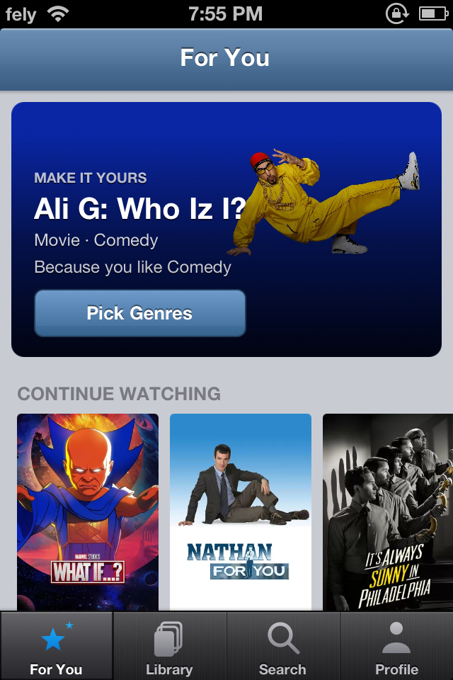
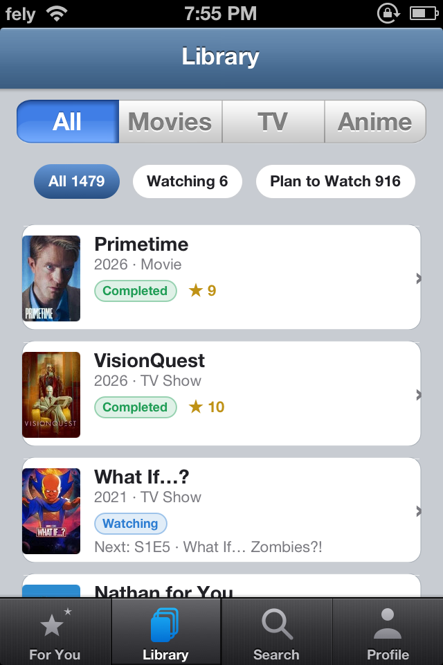
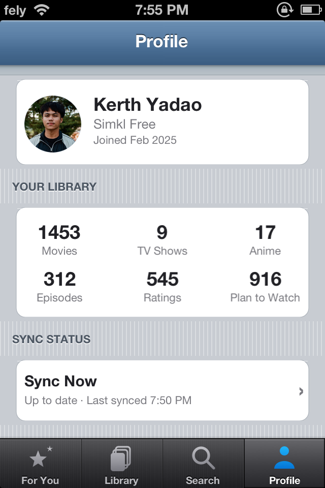

# Marquee - Simkl client for iOS 6

Marquee is a standalone, native SimKL client for iOS 6.

<p align="center">
  
  
  
</p>

## Platform support

- iOS 6.0 or later, armv7.

## Install from Cydia

Marquee is published in the KMY repo. On the device:

1. Open Cydia and choose **Sources**.
2. Tap **Edit**, then **Add**.
3. Enter `http://kerthmfy.github.io/repo/`, tap **Add Source**, then install
   Marquee from the KMY repo.

The source uses HTTP because iOS 6 cannot negotiate GitHub Pages' current TLS.
The catalog itself is available at `https://kerthmfy.github.io/repo/`.

## Build

Prerequisites:

- macOS with a compatible Xcode/iOS SDK toolchain.
- [Theos](https://theos.dev) with an iOS 6 SDK.
- `ldid` for signing.

```sh
export THEOS=$HOME/theos
make package FINALPACKAGE=1
```

The installable package is written to `packages/`. To build without packaging:

```sh
make FINALPACKAGE=1
```


## SimKL client ID

Marquee signs in with the SimKL device flow. Register an OAuth application with
SimKL, then put its client ID in `Marquee/MRConfig.h`:

```objc
#define MR_SIMKL_CLIENT_ID @"your-client-id"
```

The device flow shows a code and opens `simkl.com/pin` for approval. Tokens are
stored in the Keychain; account data and the write outbox are stored as JSON
files under the app's Library directory.


## Publishing to Cydia

The publisher expects the distribution repo as a sibling checkout:

```text
~/Documents/
  marquee-worktree/   # this repo
  repo/               # kerthmfy/repo
```

Bump `Version:` in `control`, then build and publish:

```sh
./tools/publish-cydia.sh --push
```

The script builds with Theos, verifies the `.deb`, copies it and the app art
into `repo/`, regenerates the apt indexes and site, commits, and pushes. It
refuses to overwrite a published version; bump `control` for a real update.
`REPO_DIR=/path/to/repo` overrides the sibling location, and `--no-push`
keeps everything local for review.

## Known limitations.. but will try to implement and have a workaround

- No SimKL PRO/VIP features: rewatches, custom lists, and PRO-only data.
- No scrobbling, playback sessions, or real-time progress.
- No full season/episode browser; Marquee marks the next episode or the whole
  title.
- No calendar, DVD releases, trailers, comments, social features, or imports.
- No push notifications, background sync, widgets, analytics, or crash
  reporting.
- No Core Data or SQLite; persistence is file-backed JSON.
- The app icon and launch image are temporary placeholders.
- iPad layout can be checked only when iPad hardware is available; the
  universal metrics and bundle metadata are covered by tests and package
  inspection.
