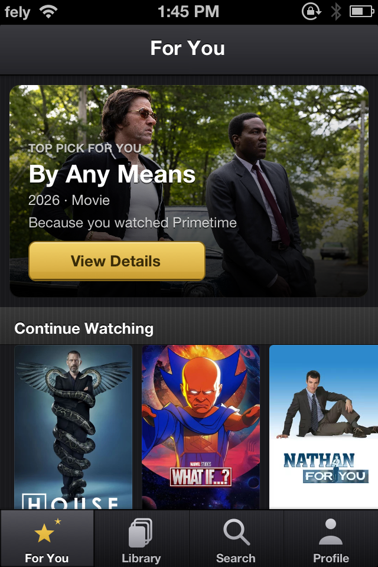
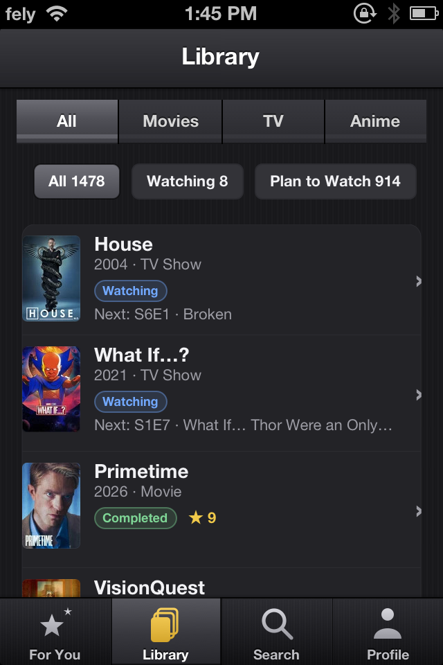
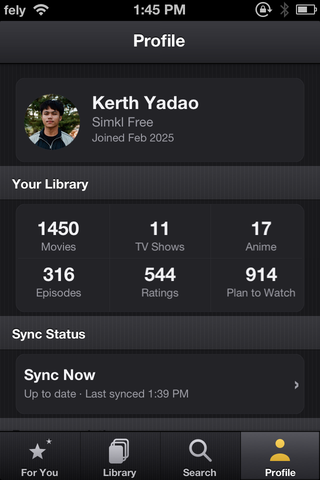

# Marquee - Simkl client for iOS 6

Marquee is a standalone, native SimKL client for iOS 6.

<p align="center">
  

<p align="center">
  
  
  
</p>


- iOS 6.0 or later, armv7.

## Install from Cydia

Marquee is published in my repo: `https://kerthmfy.github.io/repo/`

On the device:

1. Open Cydia and choose **Sources**.
2. Tap **Edit**, then **Add**.
3. Enter `https://kerthmfy.github.io/repo/`, tap **Add Source**, then install
   Marquee from the KMY repo.

Cydia's apt transport on iOS 6 can fetch this HTTPS source; the device's
command-line `curl` cannot negotiate the same TLS, so use Cydia for installs
and updates.

## Build

Prerequisites:

- macOS with a compatible Xcode/iOS SDK toolchain.
- [Theos](https://theos.dev) with an iOS 6 SDK.
- `ldid` for signing.

```sh
export THEOS=$HOME/theos
make package FINALPACKAGE=1
```

The installable package is written to `packages/`. To build without packaging:

```sh
make FINALPACKAGE=1
```


## SimKL client ID

Marquee signs in with the SimKL device flow. Register an OAuth application with
SimKL, then put its client ID in `Marquee/MRConfig.h`:

```objc
#define MR_SIMKL_CLIENT_ID @"your-client-id"
```

The device flow shows a code and opens `simkl.com/pin` for approval. Tokens are
stored in the Keychain; account data and the write outbox are stored as JSON
files under the app's Library directory.


## Publishing to Cydia

The publisher expects the distribution repo as a sibling checkout:

```text
~/Documents/
  marquee-worktree/   # this repo
  repo/               # kerthmfy/repo
```

Bump `Version:` in `control` and the two version keys in
`Marquee/Resources/Info.plist`, then build and publish:

```sh
./tools/publish-cydia.sh --push
```

The script builds with Theos, verifies the `.deb`, copies it and the app art
into `repo/`, regenerates the apt indexes and site, commits, and pushes. It
requires `repo/` to be a clean checkout on `main`, checks that the manifest slug
and image paths match `publish.conf`, and rejects equal or lower versions;
bump `control` for a real update. If a later step fails, it resets `repo/` to
the commit it started from. `REPO_DIR=/path/to/repo` overrides the sibling
location, and `--no-push` keeps everything local for review.

## future implementations

- SimKL PRO/VIP features: rewatches, custom lists, and PRO-only data.
- scrobbling, playback sessions, or real-time progress.
-  calendar, DVD releases, trailers, comments, social features, or imports.
- No push notifications, background sync, widgets, analytics, or crash
  reporting.
- the app icon and launch images are branded and ship in `Marquee/Resources`
  (`Icon*.png`, `Default*.png`).


## AI disclosure

roughly 70-80% of this project were AI assisted with my own supervision and carefully reviewing each of its output. If you're against AI-made tweaks/apps then this is not for you. These were just personal projects of mine that i'd love to share with y'all :)
